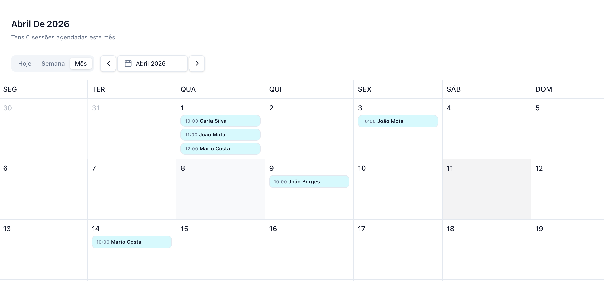

A página de calendário permite visualizar todas as sessões de forma temporal.

Para utilizar o calendário:

1. Aceda à página de **Calendário**.
2. Escolha o tipo de visualização:
   - Dia
   - Semana
   - Mês
3. Consulte todas as sessões agendadas para o período selecionado.

Esta vista permite ter uma noção clara da carga de sessões ao longo do tempo e facilita a organização da agenda.

<Frame>
  
</Frame>

***

## Eventos do Google Calendar

Se ligaste o Google Calendar em **Definições › Google Calendar**, os teus eventos do Google aparecem no calendário junto com as sessões. Para os esconderes ou voltares a mostrar, usa o botão **Google Calendar** no topo do calendário.

* No telemóvel e na vista **Mês**, os eventos ficam na mesma lista que as sessões, por ordem de hora.
* Clica num evento para o abrires no Google Calendar.
* Os eventos marcados como Ocupado no Google Calendar tiram essas horas à tua página pública. Os marcados como Livre aparecem no calendário, mas não bloqueiam nada.
