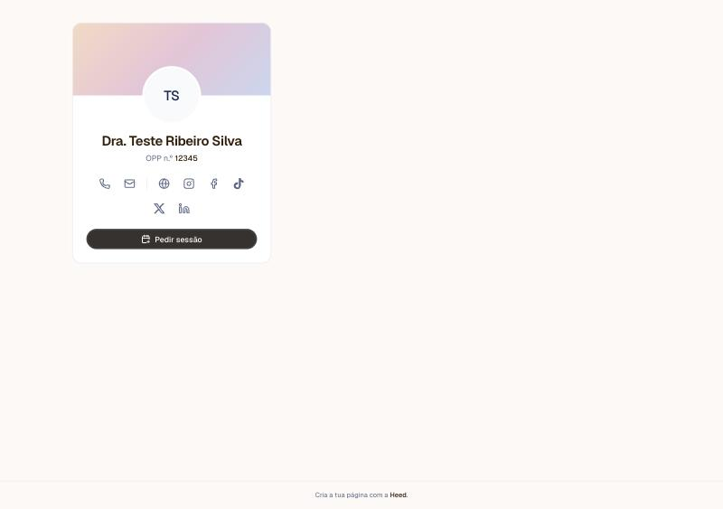
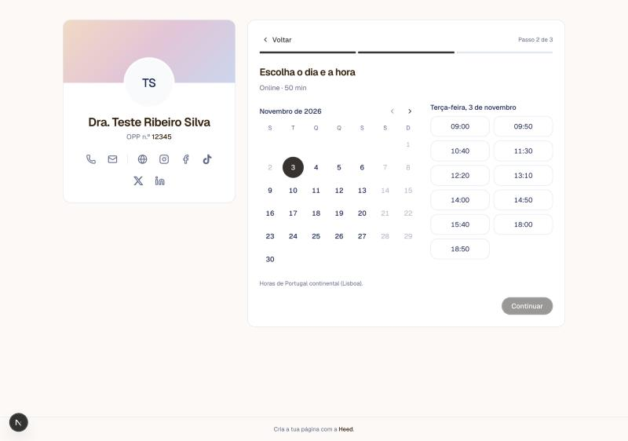

Este é o caminho que o paciente faz na tua página. Serve para saberes o que ele vê e para o ajudares, se for preciso.

<Frame>
  
</Frame>

***

## Os passos

1. O paciente clica em **Pedir sessão**.
2. Em **Que sessão quer pedir?**, escolhe um dos tipos de sessão que marcaste como disponíveis para marcação online. Cada uma diz onde acontece (online ou numa clínica), a duração e, se mostrares os valores, o preço. O paciente escolhe sempre a sessão primeiro, mesmo que só tenhas um tipo.
3. Em **Escolha o dia e a hora**, escolhe uma data e uma hora livres. As horas são de Portugal continental e carregam um mês de cada vez; enquanto carregam, o calendário aparece a cinzento. Os eventos marcados como Ocupado no teu Google Calendar também tiram horas. Só aparecem os dias dentro da [janela de marcação](/definicoes-ausencias-e-marcacao) que definiste (30, 60 ou 90 dias a partir de hoje) e, se ligaste os feriados nacionais, esses dias ficam sem horas.
4. Em **Qual é o seu email?**, escreve o email e aceita a política de privacidade. A Heed envia um código de 6 dígitos para esse email.
5. Em **Introduza o código**, escreve o código. Vale 10 minutos e tem 5 tentativas. É nesta altura que a Heed vê se o email é de um paciente teu (paciente, segunda pessoa ou responsável, mesmo em fichas inativas).
6. Quem ainda não é paciente responde às perguntas que definiste e preenche o nome, o telefone e os dados da ficha que pedires. Quem já é paciente só confirma o pedido, sem repetir dados. Se o tipo de sessão tem consentimentos, a pessoa vê no fim, em **Consentimentos**, os que ainda não aceitou na versão atual, e tem de marcar **Li e aceito** em cada um para poder enviar. Pode abrir **Ler o texto** para ver o documento inteiro antes de aceitar.
7. O ecrã **Pedido enviado** confirma que o pedido chegou. Se o pedido foi aprovado automaticamente, o ecrã diz **Sessão marcada**.

Antes de pedir o email, a Heed volta a confirmar que a hora escolhida continua livre, também no Google Calendar. Mesmo assim, alguém pode pedir essa hora enquanto o paciente confirma o email. Nesse caso, a Heed avisa que a hora já não está livre e o paciente escolhe outra, sem repetir o email.

Por omissão, tu aprovas cada pedido. Se ligaste a [aprovação automática](/definicoes-ausencias-e-marcacao#aprovação-automática), o pedido passa logo a sessão marcada. Se um paciente pedir uma sessão que não corresponde ao seu caso, por exemplo uma sessão de acompanhamento sendo novo, o pedido chega na mesma.

<Frame>
  
</Frame>

***

## Os emails que o paciente recebe

* Ao enviar, um email de **pedido recebido**. Se o pedido foi aprovado automaticamente, recebe em vez disso um email de **sessão marcada**.
* Quando aceitas, um email de **sessão confirmada**. Se a sessão for online e houver link do Google Meet, o email traz o botão **Entrar na sessão**.
* Quando recusas, um email de **pedido não aceite**, com a tua mensagem, se escreveste uma, e o botão **Escolher outra hora**.

***

## Depois da sessão marcada

Se ligaste [Cancelar e reagendar](/cancelar-e-reagendar-sessoes), o email de sessão confirmada e o lembrete trazem os botões **Reagendar** e **Cancelar sessão**, para o paciente mudar a sessão sem falar contigo.
