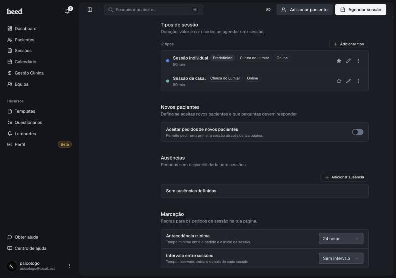

<Frame>
  
</Frame>

As regras de marcação estão em **Definições › Calendário › Marcação** e valem para todos os pedidos de sessão que chegam pela tua página. Cada alteração fica guardada logo que a fazes.

<Note>
  Estas regras vivem no teu perfil público. Se ainda não criaste o perfil, a parte **Marcação** pede-te que o faças primeiro, em **Recursos › Perfil**.
</Note>

***

## Janela de marcação

Até quantos dias à frente o paciente pode pedir uma sessão, a contar de hoje. Podes escolher **30 dias**, **60 dias** ou **90 dias**. Por omissão são 60. Com 30 dias, por exemplo, o paciente só vê horas livres no próximo mês, e um pedido para uma data mais distante é recusado.

Se reduzires a janela, os pedidos que já tinhas recebido para datas fora dela continuam válidos e decides tu.

***

## Antecedência mínima

O tempo mínimo entre o pedido e o início da sessão. Podes escolher **Sem antecedência mínima**, 2, 12, 24, 48 ou 72 horas. Com 24 horas, por exemplo, um paciente só vê horas livres a partir de amanhã a esta hora.

***

## Intervalo entre sessões

O tempo reservado antes e depois de cada sessão. Podes escolher **Sem intervalo**, 5, 10, 15 ou 30 minutos. A Heed tira estes minutos às horas livres para teres tempo entre sessões.

***

## Feriados nacionais

Liga **Feriados nacionais** para os pacientes não poderem marcar nos feriados nacionais de Portugal. Está desligado por omissão. A Heed calcula as datas sozinha todos os anos, incluindo a Sexta-feira Santa, o Domingo de Páscoa e o Corpo de Deus, por isso não tens de as indicar.

* Ficam de fora os feriados municipais e o Carnaval. Para bloquear esses dias, usa as [ausências](/definicoes-horario).
* Com o interruptor ligado, um feriado fica sem horas mesmo que tenha um horário próprio. Para abrires um feriado, desliga o interruptor.

***

## Cancelar e reagendar

Por omissão, o paciente que quer mudar uma sessão fala contigo. Ligando **Cancelar e reagendar**, passa a poder fazê-lo sozinho, a partir do email de confirmação e do lembrete. Está desligado por omissão.

1. Em **Marcação**, liga **Cancelar e reagendar**.
2. Em **Prazo para mudar**, escolhe até quantas horas antes da sessão o paciente pode mudar: **Até 24 horas antes**, **Até 36 horas antes** ou **Até 48 horas antes**. Depois deste prazo, o paciente tem de falar contigo.

Os detalhes, do que o paciente vê ao que tu recebes, estão em [Cancelar e reagendar sessões](/cancelar-e-reagendar-sessoes).

***

## Aprovação automática

Por omissão, cada pedido fica à espera de que o aceites. Com a aprovação automática, o pedido passa logo a sessão marcada, sem passares pelo Dashboard. Há três interruptores, independentes, todos desligados por omissão:

* **Aprovar automaticamente pedidos de pacientes atuais**: para quem já é teu paciente.
* **Aprovar automaticamente pedidos de novos pacientes**: para quem ainda não é teu paciente. Só aparece se aceitas novos pacientes, em **Definições › Calendário › Novos pacientes**.
* **Aprovar automaticamente reagendamentos**: para os pedidos de mudança de hora. Só aparece com **Cancelar e reagendar** ligado.

Não há limite de pedidos aprovados. O que acontece com um pedido aprovado automaticamente:

* A sessão fica marcada na tua agenda, como se a tivesses aceite. Num novo paciente, a Heed cria a ficha com os dados do pedido e guarda os consentimentos aceites. Num reagendamento, a sessão passa para a nova hora.
* Se tens o Google Calendar ligado, a sessão vai para o Google Calendar e, se for online, leva o link do Google Meet.
* O paciente vê **Sessão marcada** no fim do pedido e recebe um email de sessão marcada, em vez do de pedido enviado.
* Recebes um email, **Nova sessão marcada** (ou **Sessão reagendada**), e uma notificação na campainha com a etiqueta **Sessão marcada**.

Em alguns casos o pedido fica à espera de ti, como se a opção estivesse desligada: quando atingiste o limite de pacientes do teu plano, quando a hora deixou de estar livre ou, numa sessão online, quando o Google Calendar ligado não responde, para nunca marcar uma sessão online sem link.

***

## Onde ficaram as ausências

As ausências estão agora na parte **Disponibilidade**, a seguir ao horário semanal e aos dias com horário próprio. Ver [Definir a disponibilidade](/definicoes-horario).
