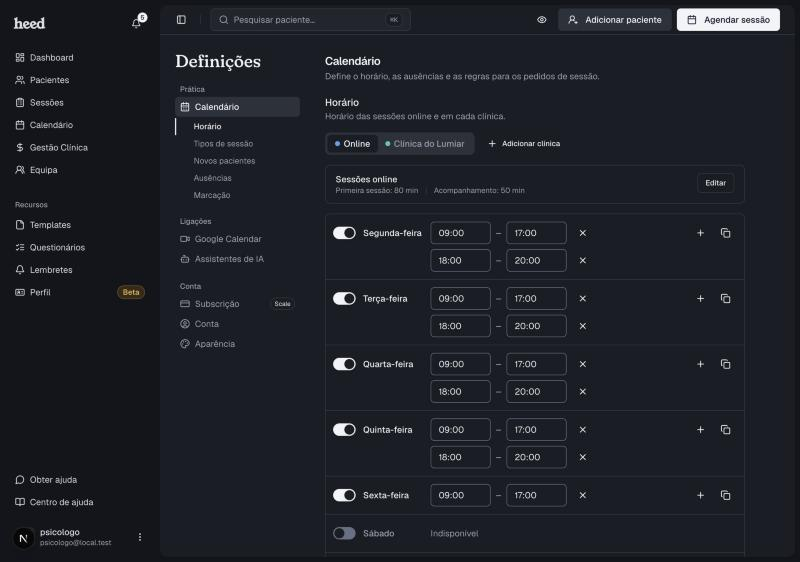

A **Disponibilidade** diz à Heed quando podes dar sessões. A página pública só mostra aos pacientes as horas livres dentro dela, sem choques com sessões já marcadas, pedidos por decidir ou ausências.

Encontras tudo num único bloco, em **Definições › Calendário › Disponibilidade**. Tem três partes, uma a seguir à outra:

* **Horário semanal**, as horas de cada dia da semana;
* **Dias com horário próprio**, para dias que fogem à rotina;
* **Ausências**, os períodos em que não atendes.

O horário semanal e os dias com horário próprio valem para o local escolhido nos separadores do topo (**Online** ou o nome de uma clínica). As ausências valem para todos os locais.

<Frame>
  
</Frame>

***

## Horário semanal

1. Em **Definições**, abre **Calendário**.
2. Em **Disponibilidade**, escolhe o separador do local: **Online** ou o nome de uma clínica.
3. Em **Horário semanal**, liga o dia da semana. Os dias desligados aparecem como **Indisponível**.
4. Escolhe a hora de início e a hora de fim.
5. Para fazeres uma pausa a meio do dia, clica no **+** e adiciona outro intervalo.
6. Para repetires o mesmo horário noutros dias, clica no ícone de copiar e escolhe os dias.
7. Clica em **Guardar horário**. Para desfazeres as alterações, clica em **Descartar**.

O botão **Guardar horário** só aparece quando há alterações por guardar.

***

## Dias com horário próprio

Para abrires um sábado avulso ou alargares uma terça sem mexeres na rotina, usa **Dias com horário próprio**. Nesses dias, o horário semanal do local deixa de contar e valem só as horas que definires. Como o horário semanal, estes dias são definidos **por local**: um dia aberto online não abre a clínica.

1. Em **Disponibilidade**, escolhe o separador do local.
2. Em **Dias com horário próprio**, clica em **Adicionar dias**.
3. No calendário, escolhe um ou mais dias. Os dias sublinhados já têm horário próprio e ficam com as horas que definires agora.
4. Define as horas desses dias. Se o dia da semana já tem horário, as horas vêm preenchidas e só ajustas o que muda. Para uma pausa, clica em **Adicionar intervalo**.
5. Clica em **Guardar**.

Para editares ou tirares um dia, usa o lápis ou o caixote do lixo na linha. Ao eliminar um dia, volta a valer o horário semanal. Os dias que já passaram saem da lista sozinhos.

<Note>
  Para não atenderes num dia, não uses um dia com horário próprio: cria uma ausência. As ausências ganham sempre sobre o horário.
</Note>

***

## Ausências

Uma ausência é um período em que não dás sessões, em qualquer local. Nesses dias e horas, a página pública não mostra horas livres.

1. Em **Disponibilidade**, vai à parte **Ausências**.
2. Clica em **Adicionar ausência**.
3. Escolhe o **Motivo**: **Férias**, **Viagem**, **Baixa médica**, **Feriado** ou **Não especificado**.
4. Escolhe o **Início** e o **Fim**. Se for o dia todo, liga **Dia completo**.
5. Guarda.

***

## Adicionar uma clínica

1. Em **Disponibilidade**, clica em **Adicionar clínica**.
2. Preenche o **Nome** e a **Morada**.
3. Define o horário dessa clínica, como em cima.

Para a tirares, abre a clínica e clica em **Eliminar clínica**. A clínica só se elimina quando já não há tipos de sessão nela: muda primeiro o local desses tipos em **Tipos de sessão**. Os pedidos que já existem mantêm o nome da clínica.

***

## Que sessões aparecem na página

Isso decides em **Tipos de sessão**, não aqui. Cada tipo tem um local (Online ou uma das clínicas) e um interruptor **Disponível para marcação online**. Os tipos com o interruptor ligado são os que os pacientes veem. Uma sessão num local sem horário não aparece na página.

Se ficares sem nenhum horário disponível, a Heed desativa a marcação online e avisa-te ao guardar.
