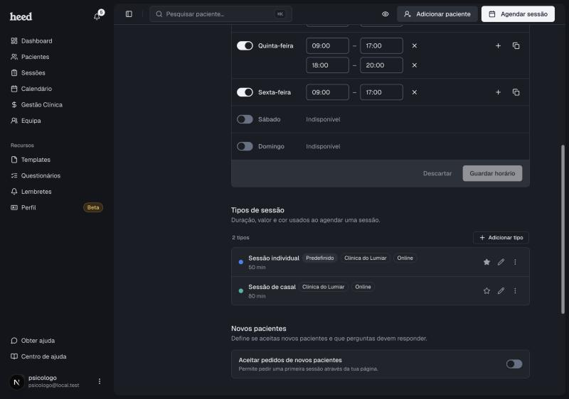

Um tipo de sessão guarda o local, a duração, o valor e a cor de uma sessão que dás, por exemplo uma sessão individual de 50 minutos online. É o que a Heed usa ao agendar uma sessão e ao calcular as horas livres da página pública.

Encontras os tipos em **Definições › Calendário › Tipos de sessão**.

<Frame>
  
</Frame>

***

## Adicionar um tipo

1. Em **Definições › Calendário**, vai a **Tipos de sessão**.
2. Clica em **Adicionar tipo**.
3. Preenche:
   * **Nome**
   * **Local**: Online ou uma das tuas clínicas (cada tipo tem um só local)
   * **Duração (minutos)**
   * **Valor (€)**
   * **Cor**
4. Se queres que os pacientes possam pedir este tipo na tua página, liga **Disponível para marcação online**.
5. Com a marcação online ligada, escolhe em **Consentimentos** os documentos que o paciente aceita ao marcar este tipo. Ver [Consentimentos na marcação](#consentimentos-na-marcação).
6. Se for o que usas na maioria das sessões, marca **Predefinido**.
7. Guarda.

Para dares a mesma sessão online e numa clínica, cria dois tipos de sessão.

***

## Consentimentos na marcação

Cada tipo de sessão marcável online tem a sua lista de **Consentimentos**. Escolhes os documentos que o paciente tem de aceitar quando marca esse tipo, por exemplo os termos do acompanhamento numa sessão individual e um consentimento próprio numa sessão de casal. Cada documento mostra a versão atual (por exemplo, v3).

Os consentimentos valem para todos os pacientes, novos e atuais. Cada pessoa só vê os que ainda não aceitou na versão atual: quem já os aceitou, por link ou numa marcação anterior, não volta a aceitar. Se criares uma nova versão de um documento, o paciente aceita-a na próxima marcação.

Só aparecem os consentimentos que já criaste e que não estão arquivados. Se ainda não tens nenhum, a lista diz **Ainda não tens modelos de consentimento** e leva-te a **Criar um modelo**. Os detalhes estão em [Consentimento informado](/consentimento-informado).

***

## Editar ou tirar um tipo

Na lista, clica no lápis para editar. O menu de três pontos tem as restantes opções. A estrela marca o tipo predefinido.

***

## Eliminar uma clínica

Uma clínica só se elimina quando já não há tipos de sessão nela. Muda primeiro o local desses tipos e depois elimina a clínica em **Definições › Calendário › Disponibilidade**.
