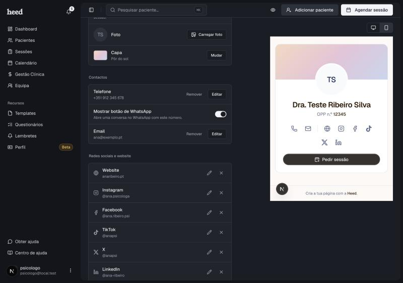
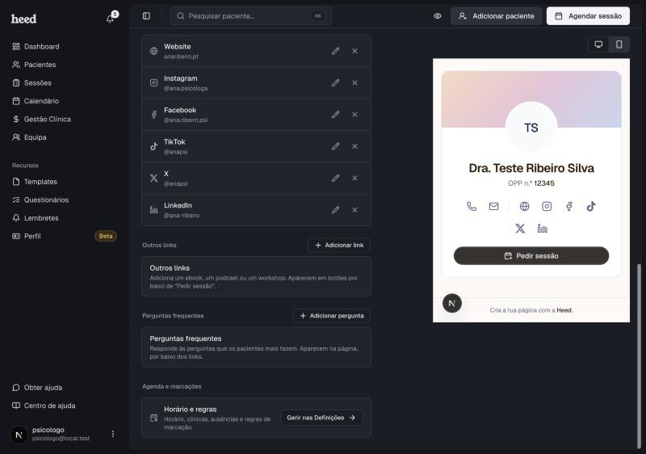

Todas as alterações são feitas em **Recursos › Perfil**. À direita tens uma pré-visualização da página, que vais vendo à medida que editas.

***

## Nome e dados profissionais

1. Na linha **Nome**, clica em **Editar**, escreve o nome como o queres mostrar e clica em **Guardar nome**.
2. Na linha **Cédula profissional**, clica em **Adicionar cédula**, escreve o número e clica em **Guardar cédula**.
3. Para esconder a cédula da página, desliga **Mostrar a cédula profissional na página**.
4. Se quiseres, na linha **Registo na ERS** faz o mesmo com **Adicionar n.º ERS**. É opcional.

***

## Foto

1. Clica em **Carregar foto**. Se já tens uma, o botão chama-se **Mudar foto**.
2. Escolhe uma imagem JPG, PNG ou WebP com menos de 20 MB.
3. Ajusta o enquadramento e o zoom.
4. Clica em **Guardar foto**.

Para tirares a foto, clica em **Remover**.

<Note>
  Se a foto vem de um iPhone em formato HEIC, converte-a para JPG antes de a carregar.
</Note>

***

## Capa

1. Na linha **Capa**, clica em **Mudar**.
2. Escolhe uma cor ou um gradiente. Há, por exemplo, Areia, Menta, Céu, Lavanda, Pêssego, Pôr do sol, Mar, Floresta e Aurora.
3. Clica em **Guardar capa**.

***

## Contactos

1. Na secção **Contactos**, adiciona o **Telefone** e o **Email** que queres mostrar.
2. Para os pacientes poderem abrir uma conversa por WhatsApp com esse número, liga **Mostrar botão de WhatsApp**.
3. Para tirares um contacto da página, clica em **Remover**.

<Frame>
  
</Frame>

***

## Redes sociais e website

Na secção **Redes sociais e website** podes juntar o **Website**, o **Instagram**, o **Facebook**, o **TikTok**, o **X** e o **LinkedIn**. Só podes ter um link por rede.

1. Clica na rede que queres adicionar.
2. Escreve o endereço ou o nome de utilizador.
3. Para mudares ou apagares, usa o lápis ou o **X** ao lado da rede.

***

## Outros links

Em **Outros links** juntas, por exemplo, um ebook, um podcast ou um workshop. Aparecem em botões por baixo de **Pedir sessão**.

1. Clica em **Adicionar link**.
2. Escreve o título (até 60 caracteres) e o endereço.
3. Guarda.

Podes ter até 6 links.

***

## Perguntas frequentes

Em **Perguntas frequentes** respondes ao que os pacientes mais perguntam. Aparecem na página, em baixo.

1. Clica em **Adicionar pergunta**.
2. Escreve a pergunta (até 200 caracteres) e a resposta (até 2000 caracteres).
3. Guarda.

Podes ter até 20 perguntas.

<Frame>
  
</Frame>
