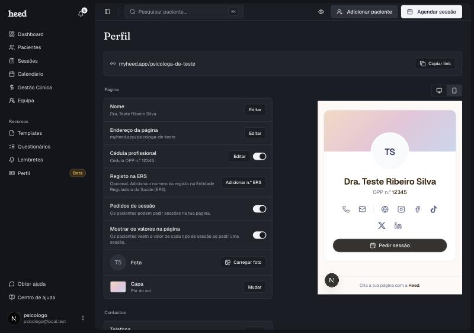

A página pública é uma página só tua, com o teu nome, a tua foto, os teus contactos e, se quiseres, um botão para os pacientes pedirem uma sessão. Tem um endereço próprio, por exemplo `myheed.app/ana-ribeiro`, que podes pôr na bio das redes sociais ou na assinatura do email.

<Note>
  A página pública está em **Beta**. Fica disponível em **Recursos › Perfil**.
</Note>

***

## Criar a tua página

1. Na barra lateral, em **Recursos**, abre **Perfil**.
2. Clica em **Criar perfil**.
3. A Heed cria um perfil vazio e abre o editor, onde preenches o resto.

A página fica pública assim que o perfil existe. Os motores de pesquisa não a indexam, por isso só a encontra quem tiver o link.

<Frame>
  
</Frame>

***

## Escolher o endereço da página

1. Em **Perfil**, na linha **Endereço da página**, clica em **Editar**.
2. Escreve o endereço que queres. Usa letras minúsculas, números e hífenes, entre 3 e 60 caracteres.
3. Espera pela indicação **Disponível**. Se aparecer **Este endereço já está a ser usado**, escolhe uma das sugestões livres.
4. Clica em **Guardar endereço**.

<Note>
  Se mudares o endereço, o link antigo deixa de funcionar. Atualiza-o onde já o tinhas partilhado.
</Note>

***

## Partilhar e pré-visualizar

* **Copiar link** copia o endereço da tua página.
* **Pré-visualizar** abre a página como os pacientes a vão ver.
* **Ver como** alterna a pré-visualização entre **Computador** e **Telemóvel**.

***

## Continuar a configurar

* [Editar a página pública](/editar-pagina-publica): nome, foto, capa, links, contactos e perguntas frequentes.
* [Pedidos de sessão](/pedidos-de-sessao-ativar): deixa os pacientes pedirem uma sessão pela tua página.
