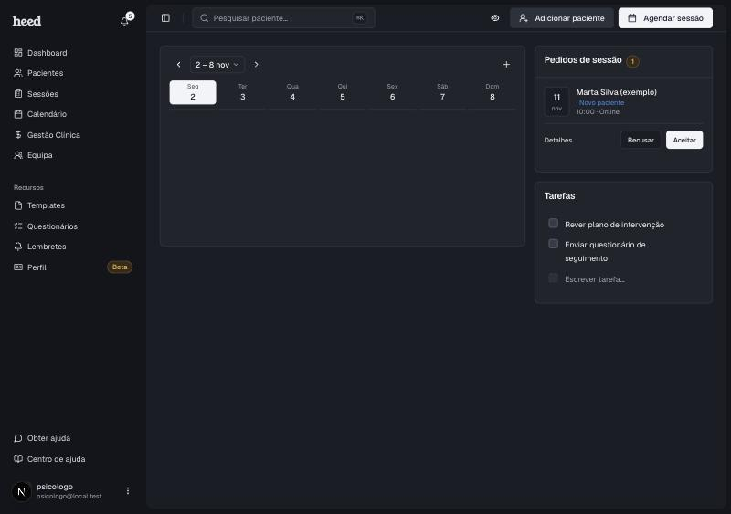
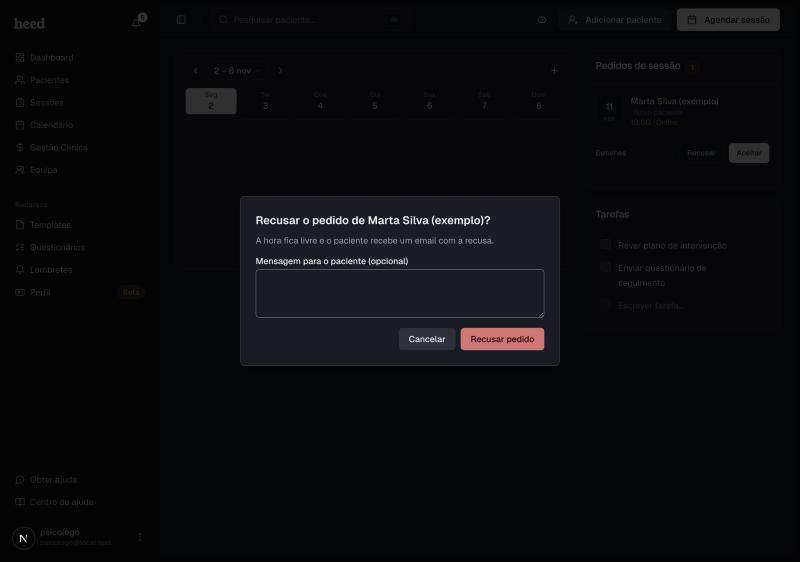

Os pedidos de sessão aparecem no **Dashboard**, no cartão **Pedidos de sessão**. Cada pedido mostra o nome, a data e a hora, o espaço e, se for o caso, a etiqueta **Novo paciente**. Também recebes um email quando chega um pedido novo.

<Frame>
  
</Frame>

***

## Ver os detalhes

Clica em **Detalhes** para veres os dados de quem pediu e, se for um novo paciente, as respostas às perguntas.

Os pedidos de reagendamento aparecem na mesma lista, com a etiqueta **Reagendamento** e a hora antiga ("antes: 12 nov, 10:00"). Ver [Cancelar e reagendar sessões](/cancelar-e-reagendar-sessoes).

***

## Aceitar um pedido

1. No cartão **Pedidos de sessão**, clica em **Aceitar**.
2. A sessão fica marcada na tua agenda. Se for online e tiveres o Google Calendar ligado, a sessão leva um link do Google Meet.
3. A pessoa recebe um email de sessão confirmada.

Se o pedido for de um novo paciente, a Heed cria o paciente e guarda as respostas como **Primeiro contacto**. Se a sessão for online, a ficha fica com a modalidade **Online**. Se o tipo de sessão tem consentimentos, os que a pessoa aceitou ao pedir a sessão ficam na ficha, com a versão e a data da aceitação, seja um novo paciente ou um paciente atual. Se o pedido for um reagendamento, a sessão passa para a nova hora e o paciente recebe um email **Sessão reagendada**.

Se a data do pedido já passou, o pedido tem a indicação **Data passada**.

***

## Pedidos aprovados automaticamente

Se ligaste a [aprovação automática](/definicoes-ausencias-e-marcacao#aprovação-automática), os pedidos desse tipo não passam pelo cartão **Pedidos de sessão**. A sessão fica logo marcada, recebes um email **Nova sessão marcada** e uma notificação com a etiqueta **Sessão marcada**. Para mudares ou cancelares uma sessão aprovada assim, abre-a no calendário.

***

## Recusar um pedido

1. Clica em **Recusar**.
2. Se quiseres, escreve uma **Mensagem para o paciente**.
3. Clica em **Recusar pedido**.

A hora fica livre e o paciente recebe um email com a recusa, com um botão para escolher outra hora. Num reagendamento, a sessão continua na hora antiga e o email diz qual é.

Se recusares um pedido de um novo paciente, não fica nada guardado: nem o paciente nem os consentimentos que a pessoa aceitou.

<Frame>
  
</Frame>

***

## Se não conseguires aceitar

A Heed avisa-te no ecrã quando um pedido não se pode aceitar. Os casos mais comuns são a hora já estar ocupada, o pedido já ter sido decidido, ter sido atingido o limite de pacientes do teu plano ou faltar o tipo de sessão do espaço.
